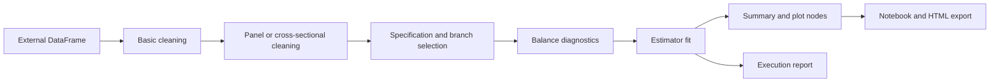

# Architecture of the shipped causal pipelines

This document describes version 0.1.2. The project combines a reusable graph executor with example causal-analysis graphs. Routing is based on data structure; causal identification remains a research-design decision.

## Components and responsibilities

| Component | Responsibility | Source |
| --- | --- | --- |
| `ExecutableGraph` | Input binding, conditional execution, joining and composition, reset and execution diagnostics. | [orchestration/graph.py](../pyautocausal/orchestration/graph.py) |
| Input, action and decision nodes | Type-check external values, call functions and track execution state. | [orchestration/nodes.py](../pyautocausal/orchestration/nodes.py) |
| `RunContext` | Supply per-run parameter values and metadata separately from graph structure. | [orchestration/run_context.py](../pyautocausal/orchestration/run_context.py) |
| `AutoCleaner` and validators | Apply explicit cleaning rules and validate the retained design. | [data_cleaner_interface](../pyautocausal/data_cleaner_interface/) |
| Specifications and estimators | Construct model inputs, fit supported methods and attach model/inference results. | [pipelines/library](../pyautocausal/pipelines/library/) |
| Pipeline builders | Assemble common cleaning, routing, estimation and output nodes. | [pipelines/example_graph](../pyautocausal/pipelines/example_graph/) |
| Persistence | Save values/figures, serialize graph definitions, generate notebooks and HTML. | [persistence](../pyautocausal/persistence/) |

## Public entry points and input contract

`create_panel_graph(output_dir, ...)` and `create_cross_sectional_graph(output_dir, ...)` each return an `ExecutableGraph`. Execute it with `graph.fit(df=dataframe)`. `fit()` returns the graph; retrieve a node's value with `graph.get(name).get_result_value()`.

The builders accept a pandas DataFrame, not a file path. Read CSV or Parquet explicitly before calling `fit()`. Both builders require `y` and binary `treat`; panel data also requires `id_unit` and `t`. The canonical time column is **`t`**, not `period`. Unit IDs may be strings. Multiple outcomes, multiple treatment columns and continuous treatment are not accepted automatically by these builders.

Cleaning defaults to `missing_strategy="drop_rows"` with `max_missing_fraction=0.1`; `"reject"` refuses missing values. The threshold is assessed against the original input sample before dropping rows. Panel cleaning preserves distinct time values, validates unique unit/time observations and rechecks treatment/comparison support after cleaning. See [data requirements](data-requirements.md) for the full contract, covariate selection and recorded cleaning metadata.

## Analysis construction and routing

Users select the builder. The cross-sectional graph creates a cross-sectional specification, balance diagnostics and an OLS fit. The panel graph chooses among standard DiD, common-timing event study, staggered event study with Callaway–Sant'Anna, and synthetic methods. Exact conditions and limits are documented in [panel routing](did_flow.md).

Balance diagnostics do not trigger automatic weighting or a switch to high-dimensional methods. Double-selection Lasso, experimental uplift estimators and DoubleML have separate APIs; their availability does not mean they run in the default graphs. See [causal methods](causal-methods.md).

The branch-builder helpers require an existing shared cleaning/decision structure. They check their named prerequisites and raise before modifying the graph if prerequisites are missing. Use the public complete builders for a ready-to-fit graph; use `ExecutableGraph` for custom designs.

## Execution model

Nodes start `pending`, execute once and finish as `completed`, `failed` or `passed` (skipped). Decisions retain their true/false branch registrations and pass available inputs to selected successors. The scheduler recomputes readiness after each node, including skips, so joins can run when their predecessors are completed or skipped and their edges are traversable.

Predecessor dictionaries bind function parameters explicitly; a list of source names within one binding represents alternative providers. Multiple completed alternatives are ambiguous and raise an error. Skipped nodes supply no value. Run-context values fill unbound parameters, followed by callable defaults. See [building pipelines](pipeline-guide.md) for executable examples.

`merge_with` copies the right graph into the left, preserving branch membership and binding aliases when names collide. Both graphs must be pending; the right graph remains independent. `reset()` clears execution state and results while preserving runtime configuration. Graph execution is sequential; no parallel or distributed scheduler is provided.

Errors propagate rather than producing a successful partial analysis. `execution_report()` records node state, failure details and available analysis provenance. A stalled or cyclic graph raises an actionable error. Completed/skipped nodes indicate the selected path; they do not by themselves validate statistical assumptions.

## Persistence and replay

Graph structure and runtime settings are separate. YAML round-trips nodes, callables, branch registrations, bindings, descriptions and output configuration. Fitted results, active output handlers and run-context values are not restored from YAML; configure the loaded graph and fit it again.

Node persistence uses `OutputConfig` and an output handler. JSON scalars/lists, tabular data, text and explicit figure objects have supported formats. Result objects differ across estimators; a single unified coefficient-table or plotting interface is not yet implemented.

`export_outputs(graph, df=..., output_path=...)` writes a graph visualization, a checked data snapshot, a replay notebook, executed HTML and `execution_report.json`. The CSV copy supports inspection; the notebook reads the Parquet snapshot to preserve types and labels. Failures are recorded by export stage and raised.

Notebook exports linearize only the completed path and include original failures/skips and provenance as diagnostics. They can import package helpers and require the matching environment; they are not dependency-free bundles. Changing input data may require rerunning the graph to select a different path. The [pipeline guide](pipeline-guide.md#exporting-a-reproducible-notebook-and-html-report) explains loaders, run-context replay and compact reports.

## Validation and unfinished product work

Correctness regressions cover treatment coding, time boundaries, control forwarding, cleaning, graph composition/joins and persistence. CI also tests installed wheels across supported Python versions and notebook/DoubleML extras. Statistical simulation checks and their limits are documented in [statistical validation](causal-methods.md#validation-scope); development commands are in [contributing](../CONTRIBUTING.md).

Interactive CLI guidance, package-free standalone notebooks and a unified result presentation remain scoped enhancements. Automatic causal-assumption validation, power analysis, missingness-mechanism detection and the earlier proposed estimator-selection tree are not implemented capabilities. Track accepted work in [issue triage](issue-triage.md) and behavioral corrections in the [changelog](../CHANGELOG.md).
