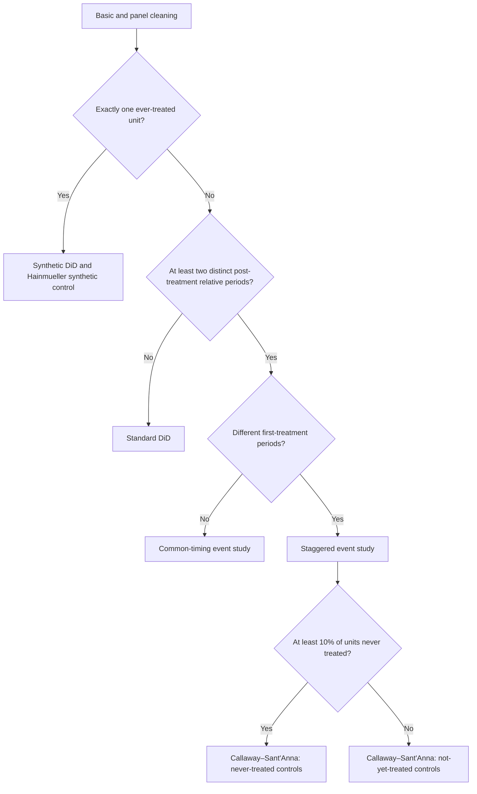

# Panel routing and DiD design decisions

This page describes the routing implemented by `create_panel_graph` in version 0.1.2. The graph chooses among available branches from observed data structure. It does not establish the causal assumptions needed to interpret an estimate.

Start with the [input contract](data-requirements.md), then choose the panel or cross-sectional builder explicitly. The public builders do not share an automatic top-level data-type selector.

## Implemented panel routing

The staggered path fits a panel event-study model and one Callaway–Sant'Anna comparison-group variant. The single-treated-unit path fits both synthetic methods and includes Hainmueller placebo diagnostics. Balance summaries are attached to specifications; balance results do not automatically select a weighted estimator.

The post-period decision counts distinct nonnegative relative periods in the cleaned panel, including treatment onset as period zero. It is a routing rule, not a check that every treated unit has the same follow-up support. The never-treated decision uses the fraction of distinct units, with a default threshold of 10%; it is not a test of whether those units form a credible comparison group.

Implementation: [core routing](../pyautocausal/pipelines/example_graph/core.py), [branch construction](../pyautocausal/pipelines/example_graph/branches.py), and [decision conditions](../pyautocausal/pipelines/library/conditions.py).

## Decisions the analyst must make

Before interpreting any branch, define the target population, treatment contrast and time window. Choose comparison units based on the research design, and assess parallel trends, anticipation, spillovers, selection and covariate support as appropriate. A branch selected by data shape does not validate these assumptions.

For staggered adoption, inspect cohort/time support and decide whether never-treated or not-yet-treated comparisons answer the intended question. The default 10% routing threshold cannot make that choice on substantive grounds. The [method guide](causal-methods.md) describes the available specifications and estimator APIs for an explicit choice of method and controls.

Treat the staggered panel regression and Callaway–Sant'Anna outputs as different estimators. Do not assume their coefficients have the same aggregation or interpretation simply because both appear in one report. Review effect definitions and inference metadata before comparing them.

Cleaning can change comparison support. The provided cleaners revalidate the remaining design and record dropped observations. Review that audit before fitting or interpreting results; see [missing-data handling](data-requirements.md).

## Scope and limits

The shipped graph does not implement automatic power analysis, missingness-mechanism identification, sensitivity bounds, weight decompositions or an omnibus test of causal identification. It does not automatically select Sun–Abraham, imputation DiD, stacked DiD or local-projection estimators. The earlier conceptual flow on this page listed those options; they were not implemented graph branches.

For uncertainty, use the scope documented in [statistical validation](causal-methods.md#validation-scope). A successful run records completed/skipped nodes, estimator settings and available inference information; it does not certify a study's design. Review the [0.1.2 correction notes](../CHANGELOG.md) before reusing earlier analyses.
